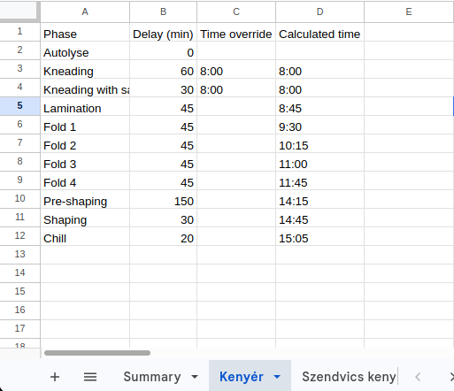
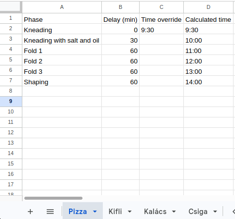
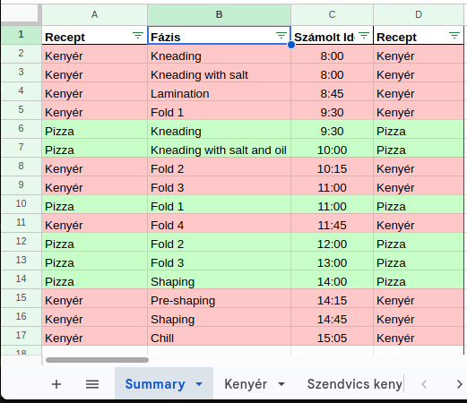

# Baking Time Plan

[](https://github.com/atihauber/baking-time-plan/actions/workflows/test.yml)

A Google Sheets script that plans your bakes. Enter a start time for a recipe, and it fills in when every following step is due. A `Summary` sheet merges all recipes into one color-coded timeline.

<table>
  <tr>
    <td></td>
    <td></td>
    <td></td>
  </tr>
</table>

## Setup

1. In a Google spreadsheet, add a sheet named `Summary` and one sheet per recipe (layout below).
2. Open **Extensions → Apps Script** and replace the editor's content with [`src/recipe_timer.js`](src/recipe_timer.js).
3. Select `setUpTrigger`, click **Run**, and grant the permissions.
4. Type a time in column C of a recipe. The times and the summary update on their own.

## Recipe sheet layout

Row 1 holds headers (any text); phases start in row 2, in order.

| Column | Contents |
| --- | --- |
| A | Phase name |
| B | Delay in minutes after the previous phase (e.g. `45`, or a duration like `3:30`) |
| C | Time you set by hand (optional) |
| D | Calculated time, written by the script |

See [`examples/spreadsheet-layout.md`](examples/spreadsheet-layout.md) for a worked example.

## How times are calculated

- The first row with a time in column C is the start. Rows above it stay empty.
- Each following row gets the previous time plus its delay, unless it has its own time in column C, which then takes over.
- Rows without a phase name are skipped.
- A value the script cannot read shows `⚠ invalid time` or `⚠ invalid delay` and is skipped.

## Good to know

- **Every sheet except `Summary` counts as a recipe**, and its column D is overwritten. Keep notes in another spreadsheet or to the right of column D.
- The `Summary` is rewritten automatically; don't type in it.
- Updates follow edits, inserted or deleted rows, and added, renamed or deleted sheets. To force a full refresh, run `handleEdit` in the Apps Script editor.
- Overnight schedules: a time you type for after midnight counts as the same day, so it sorts before the evening ([#7](https://github.com/atihauber/baking-time-plan/issues/7)).

## Troubleshooting

- **Nothing updates:** in Apps Script, check that **Triggers** lists `handleEdit` and `handleChange`, and look for errors under **Executions**. Run `setUpTrigger` again after updating the script.
- **No times appear:** at least one row needs a time in column C.

## Development

The code in `src/` is synced with Apps Script through [clasp](https://github.com/google/clasp) and tested with Jest:

```
npm install
npx clasp login && npx clasp clone <scriptId> --rootDir src
npm test          # run the tests
npm run push      # upload src/ to Apps Script
```

See [CONTRIBUTING.md](CONTRIBUTING.md) for details. Released under the [MIT License](LICENSE).
